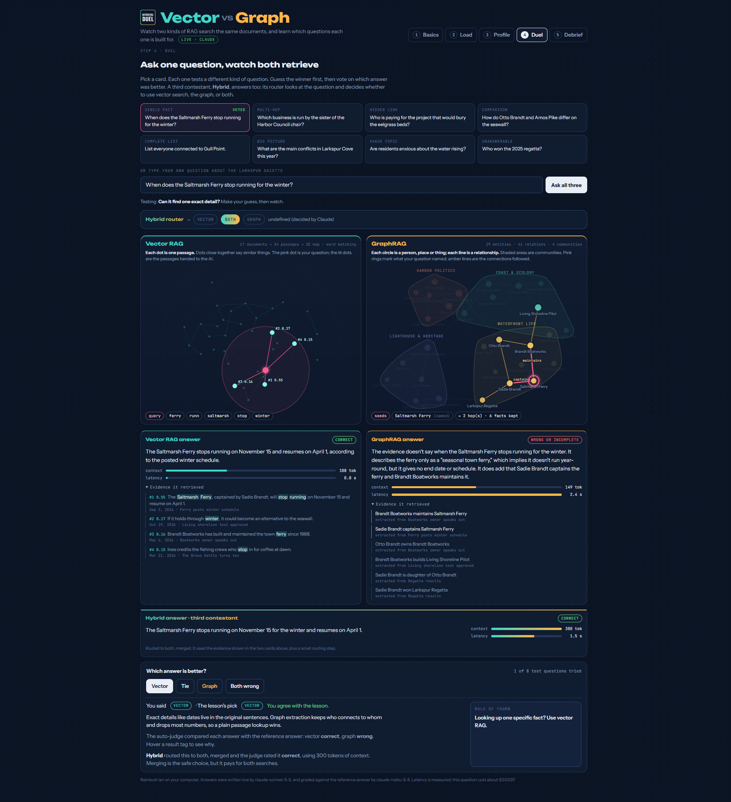
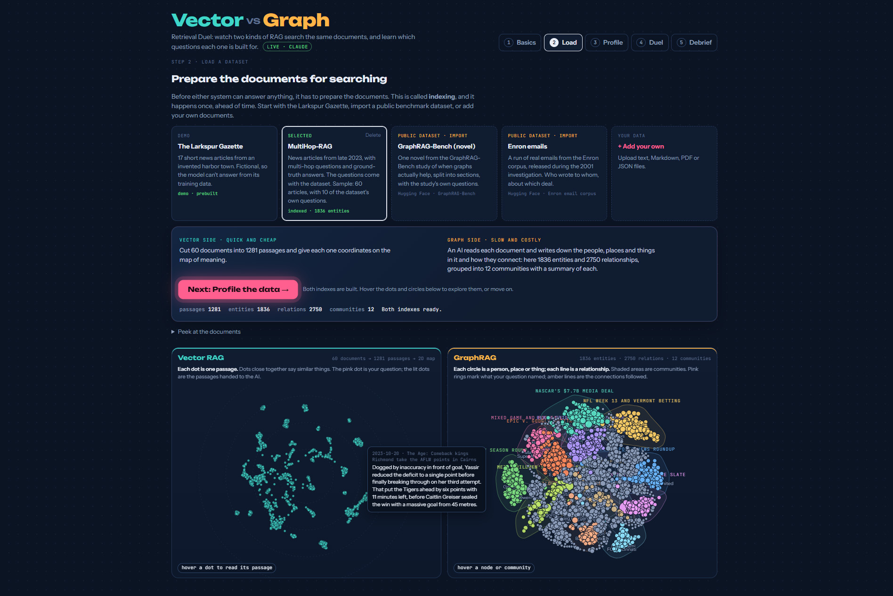

# Retrieval Duel

**This app compares Vector RAG, GraphRAG, a simple Hybrid and an Agentic retriever, side by side.** It's also a hands-on tutorial: load a set of documents, watch both kinds of retrieval index them, then ask questions and watch each one search, with the evidence it found laid out so you can judge. It generates test questions designed to expose each method's strengths and blind spots, and grades the answers.

It's built for learning, not production. Everything is small, visible and explained.



## What's inside

1. **Basics**: an 8-screen walkthrough for people who've never heard of RAG.
2. **Load**: pick the built-in demo or upload your own files, see a cost estimate, then index. Vector embeddings run on your computer; Claude reads each document to build the knowledge graph.
3. **Profile**: what kind of corpus this is, and what that predicts (how connected it is, how many details survive extraction, what indexing cost).
4. **Duel**: ask a question. Four contestants answer: Vector RAG, GraphRAG, a simple Hybrid router, and an Agentic retriever that shows each step of its reasoning. Retrieval is animated on a 2D map of passages and on the knowledge graph.
5. **Debrief**: your results by question type, plus a guide to when to use which.



The demo dataset, **The Larkspur Gazette**, is 17 short articles about a fictional harbor town, so the AI can't answer from its training data. Its graph is prebuilt and its sample answers are pre-written, so it works with no API key.

## Hosting the demo on Vercel

The repo includes `vercel.json` and `api/index.py`, so you can host a public, keyless demo on Vercel's free Hobby plan:

1. At [vercel.com](https://vercel.com), choose **Add New → Project** and import this GitHub repo.
2. Framework Preset: **Other**. Root Directory: `./`. Leave the build settings empty.
3. Deploy. No environment variables are needed.

The hosted version runs in **public demo mode**: only the Larkspur Gazette, with pre-written answers; uploads, imports and indexing are switched off; votes stay in each visitor's browser; and it never calls Claude, even if you add a key, so strangers can't run up a bill. Retrieval still runs live, so visitors can type their own questions and watch both searches work. The import and upload cards point visitors to this repo to run the full version locally.

## Quick start (Windows)

1. Install **Python 3.10 or newer** from [python.org](https://www.python.org/downloads/). During setup, tick **"Add python.exe to PATH."**
2. Get the code: `git clone https://github.com/ghelmstetter/retrieval-duel.git`, then open the folder.
3. **Double-click `run.bat`.** The first time, it creates a private Python environment, installs the libraries (a few minutes), creates a `.env` file, and opens the app in your browser at http://localhost:8000.
4. For live answers and your own datasets, open `.env` in Notepad, paste your key after `ANTHROPIC_API_KEY=`, save, close the black window, and double-click `run.bat` again.

To update later: `git pull`, then `run.bat`.

Then read the **[user guide](docs/USER-GUIDE.md)** for a walkthrough of every step, the settings, and troubleshooting.

<details><summary>Manual setup (Mac, Linux, or if you prefer the terminal)</summary>

```bash
python -m venv .venv
# Windows: .venv\Scripts\activate     Mac/Linux: source .venv/bin/activate
pip install -r requirements.txt
pip install fastembed        # optional but recommended: real meaning-based embeddings
cp .env.example .env         # Windows: copy .env.example .env   then add your key
python -m rduel
```
</details>

## Costs and safety

- **Graph indexing is the expensive part.** Claude reads every document once. The Load step shows an estimate before you start, and `RDUEL_MAX_INDEX_DOLLARS` in `.env` (default $2) stops a run that goes over.
- **Every AI call is cached** in `data/cache`, so re-indexing the same text, or asking the same question again, is free.
- **Each question** costs three answer calls plus a little routing and grading, typically a cent or two.
- Start small: 20 to 200 documents. Set a spending limit in the [Anthropic console](https://console.anthropic.com/) too.
- Your key lives only in `.env`, which is excluded from git. Uploaded files stay in `data/` on your computer; their text is sent to the Anthropic API when you index or ask.

## Your own data

Upload `.txt`, `.md`, `.pdf`, `.json` or `.jsonl` files. For JSON/JSONL, each record needs a `text` field (or `body`/`content`), and optionally `title` and `date`.

### Built-in public datasets

The Load page has one-click imports that download a small sample from Hugging Face on your computer:

- **MultiHop-RAG** (yixuantt/MultiHopRAG, ODC-By): news articles from late 2023. The sample is built around some of the dataset's own multi-hop, comparison, temporal and unanswerable questions, so you also get **benchmark questions with official reference answers**, plus distractor articles.
- **GraphRAG-Bench (novel)**: one novel from the 2025 study, split into sections, with the study's own questions whose evidence falls inside the sample.
- **Enron emails**: a run of consecutive emails from the public Enron corpus, with sender, recipients and subject kept and quoted replies trimmed.

Choose small, medium or large. Nothing is sent to Claude until you click Index, and the cost estimate shows first. Some Hugging Face datasets require accepting terms; if an import reports a 401/403 error, accept them on huggingface.co and add `HF_TOKEN=...` to `.env`.

## How it works

| | Vector RAG | GraphRAG | Hybrid |
|---|---|---|---|
| Indexing | Cut into passages, embed each (fastembed `bge-small`, on your computer) | Claude extracts entities and relationships from each document; duplicates are merged; Louvain community detection; Claude summarizes each community | Uses both indexes |
| Search | Nearest passages to the question (top 5) | **Local:** find entities the question names (or resembles), walk 2 hops, keep the most relevant 30 facts. **Global:** for big-picture questions, read the community summaries | A router (Claude, or simple rules without a key) sends the question to vector, graph, or both |
| Answer | Claude answers from the passages only | Claude answers from the facts or summaries only | Claude answers from the chosen evidence |

**Agentic** works in a loop instead of one shot: Claude rewrites the question into the words the documents are likely to use, picks one or two searches (vector, a graph walk from entities it names, or the community summaries), checks whether the evidence is enough, and if not chooses a follow-up search, up to three in total. Then it answers from everything it gathered. Its card shows every step with its token cost. Without an API key it can't think, so it falls back to simple rules; in the demo, each sample question has a pre-written plan whose searches still run live.

**Case study: "Who is in charge of the town?"** The Larkspur demo includes this question because it came up in real testing and every one-shot approach fails on it, each for a different reason. Vector search matches only "town" (the article says "chair" and "council"), GraphRAG has no name to start from, and the simple Hybrid routes to vector search and answers from the wrong passages. The agent rewrites the question, finds Mara Quill's election as council chair, notices it can't yet rule out a mayor, and walks the graph from the Harbor Council to confirm.

**Test questions** are generated per type: a single fact (a passage with a number), multi-hop and hidden-link chains (two-step paths in the graph whose facts come from different documents; "hidden link" means vector search was checked and missed the second document), a comparison, a complete list (the best-connected entity), a big-picture question (from community summaries), a vague question (a passage that names no entities), and an unanswerable one (a detail the passage doesn't contain). Each comes with a reference answer, and Claude grades all three answers against it.

**Simplifications, on purpose:** this is a teaching version of GraphRAG, not a reproduction of Microsoft's. Entity merging is name-based, global search reads all summaries in one call instead of a full map-reduce, and the graph answer deliberately gets only extracted facts (no original text) so you can see what extraction loses. Generated questions lean on the graph, so a bad extraction can produce a bad question; check the reference answer when a result looks odd.

Without fastembed, embeddings fall back to TF-IDF word matching, which only matches shared words. The demo uses word matching on purpose, so it behaves exactly as described in its lessons.

## Project layout

```
rduel/            Python package
  config.py       settings from .env
  llm.py          Claude calls, disk cache, token and cost metering
  textutil.py     reading files, sentences, chunking
  embed.py        fastembed or TF-IDF embeddings
  vector_index.py vector search and the 2D map
  graph_index.py  extraction, entity merging, communities, local/global search
  questions.py    test-question generator
  qa.py           router, answer prompt, auto-judge
  agent.py        the Agentic contestant: plan, search, check, search again
  catalog.py      one-click importers for public datasets
  pipeline.py     datasets, indexing job, asking all three
  server.py       web API (Starlette)
web/              the page (HTML, CSS, JS with D3 for the visuals)
docs/USER-GUIDE.md  full walkthrough
demo/larkspur/    the demo dataset with its prebuilt graph
run.bat           one-click setup and start for Windows
api/index.py      Vercel entry point (public demo mode)
vercel.json       Vercel configuration
tests/            offline tests (python -m tests.test_catalog, python -m tests.test_llm_json)
```

## Ideas for later

A reranker, keyword (BM25) search as another contestant, and side-by-side runs of Microsoft GraphRAG or LightRAG on the same corpus.

## License

[MIT](LICENSE) © 2026 Greg Helmstetter. You're free to use, change, and share this code, including commercially, as long as the copyright notice stays with it. D3.js is included under its ISC license. Imported datasets aren't part of this repository and keep their own licenses (see [LICENSE](LICENSE)).
